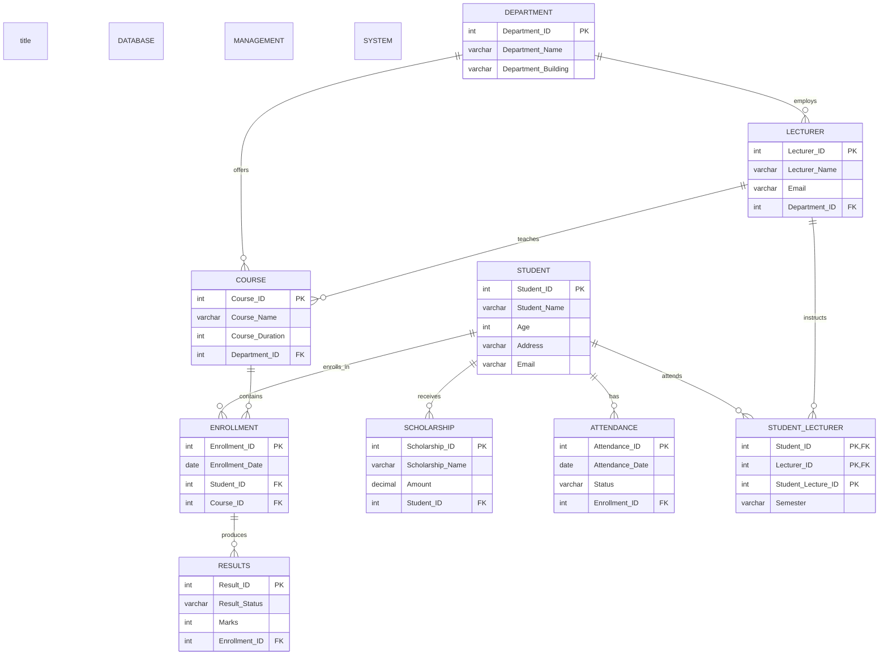

# STUDENT DATABASE MANAGEMENT SYSTEM

The ERD for the Student Management System contains eight main entities, with the following relationships and attributes.

## Department
- Department_ID (PK)
- Department_Name
- Department_Building

## Lecturer
- Lecturer_ID (PK)
- Lecturer_Name
- Email
- Department_ID (FK)

## Course
- Course_ID (PK)
- Course_Name
- Course_Duration
- Department_ID (FK)
- Lecturer_ID (FK)

## Student
- Student_ID (PK)
- Student_Name
- Email
- Address
- Age

## Enrollment
- Enrollment_ID (PK)
- Enrollment_Date
- Student_ID (FK)
- Course_ID (FK)

## Result
- Result_ID (PK)
- Marks
- Result_Status
- Enrollment_ID (FK)

## Scholarship
- Scholarship_ID (PK)
- Scholarship_Name
- Amount
- Student_ID (FK)

## Attendance
- Attendance_ID (PK)
- Attendance_Date
- Status
- Enrollment_ID (FK)

## Student_Lecturer
- Student_ID (PK, FK)
- Lecturer_ID (PK, FK)
- Student_Lecture_ID (PK)
- Semester

## Relationship Summary
- Department has many Course records
- Department has many Lecturer records
- Lecturer teaches many Course records
- Student enrolls in many Course records
- Course has many Enrollment records
- Student has many Attendance records
- Student receives many Scholarship records
- Student receives one Result per Course
- Student and Lecturer are linked through Student_Lecturer for course delivery records

## Cardinality Overview
- One department to many courses
- One department to many lecturers
- One lecturer to many courses
- One student to many enrollments
- One course to many enrollments
- One student to many attendance records
- One student to many scholarships
- One enrollment to many results
- One student to many lecturer-course associations
